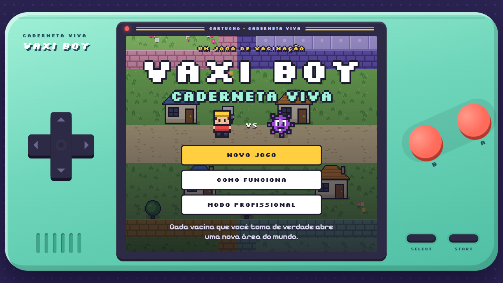

# Vaxi Boy · Caderneta Viva

Jogo de exploração em pixel art feito para incentivar a vacinação entre jovens de 10 a 15 anos. A ideia é transformar a caderneta de vacinação em algo que dá vontade de completar: **cada vacina tomada de verdade libera uma área nova do mundo.**



## Como funciona

1. O jogador começa na vila e conhece os moradores.
2. Ao tomar uma vacina no posto de saúde, o profissional libera essa vacina no celular do jovem (no protótipo, por QR Code, com conceito de NFC).
3. A vacina abre uma região nova, cada uma com seu tema e personagem:

| Vacina | Região | Guardião |
|---|---|---|
| HPV | Jardim Escudo | Dra. Flora |
| Meningocócica ACWY | Torre da Mente | Prof. Neuro |
| dT (dupla adulto) | Porto Ferrugem | Capitã Tétis |
| Influenza | Pico dos Ventos | Mestre Brisa |
| Febre amarela | Mata Dourada | Guarda Sagui |
| Dengue | Lagoa Parada | Sra. Garça |
| Hepatite B | Usina do Fígado | Eng. Hepa |
| Tríplice viral | Ilhas Tríplices | Capitão Trio |

Cada região explica, de um jeito leve, contra o que aquela vacina protege.

## Funcionalidades

- Visual de console portátil, com direcional e botões A/B clicáveis.
- Pensado primeiro para celular (toque), mas também funciona com teclado.
- **Modo profissional:** gera um código de liberação (com dígito verificador, para não dar pra inventar um) e o QR Code correspondente.
- O jovem libera a vacina digitando o código ou tirando uma foto do QR Code com o celular.
- Progresso salvo no próprio aparelho.
- Tudo num único arquivo HTML, sem build e sem servidor.

## Como rodar

Abra o `index.html` no navegador. Se quiser testar pelo celular na mesma rede:

```bash
npx serve .
```

## Tecnologias

HTML, CSS e JavaScript puro, Canvas, [qrcode-generator](https://github.com/kazuhikoarase/qrcode-generator) e [jsQR](https://github.com/cozmo/jsQR).

## Contexto

Projeto conceitual desenvolvido para um trabalho acadêmico. A integração com a caderneta digital do SUS é só uma proposta: aqui ela é simulada.
